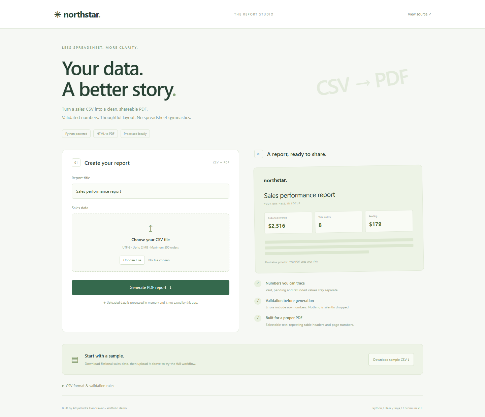

# Northstar — CSV to PDF Reports

A Python portfolio project by **Afrijal Indra Hendrawan**. Turn validated sales CSV into a polished, selectable-text PDF using a real **Jinja HTML template and Chromium print rendering**. Includes a local upload UI, command-line automation, sample inputs and regression tests.



## Quick start

Requires Python 3.12+ and a Playwright Chromium installation.

```sh
python -m venv .venv
# Windows:
.venv\Scripts\activate
# macOS / Linux: source .venv/bin/activate
pip install -r requirements.txt
python -m playwright install chromium
python app.py
```

Open http://127.0.0.1:8103. Download the sample CSV, choose it in the upload form and generate the PDF. Uploaded content is processed in memory and is not saved by the app. PDF generation uses no external resource requests. The browser and operating system may use temporary storage internally.

After setup on Windows, `start-reports.bat` launches the UI. If using an installed Chrome instead of Playwright's bundled Chromium, set `$env:REPORT_CHROME_CHANNEL='chrome'` in PowerShell. The launch script uses this fallback on the original development machine; other machines can use the standard setup above.

## Command-line workflow

```sh
python reports.py examples/sales.csv --output generated/sales-report.pdf
python reports.py examples/sales.csv --output generated/october.pdf --title "October sales review"
```

Invalid data exits with status 2 and row-numbered messages. Validation completes before PDF generation; no partial report is emitted for invalid input. Existing output is replaced only after successful generation; choose a new output name if you need to preserve an older report. The output cannot overwrite the input CSV.

## CSV contract

Required columns **in this order**:

```csv
order_id,date,customer,product,category,quantity,unit_price,status
ORD-1,2026-10-01,Ada Example,Notebook,Stationery,3,12.50,Paid
```

- UTF-8 (BOM accepted), comma-separated, standard CSV quoting. Quoted commas in names are supported.
- Maximum 2 MB, 500 data rows and 80 characters per field. All fields required. Surrounding whitespace is stripped. Control characters are rejected.
- Order IDs: unique, case-sensitive, 1–32 letters, numbers, hyphens or underscores. One row represents one order/product; multi-line orders with repeated IDs are not supported.
- Date: a valid calendar date in `YYYY-MM-DD` form.
- Quantity: integer 1–9999. Unit price: USD 0–9999999.99, at most two decimal places, no thousands separators, symbols or exponent notation.
- Status: exactly `Paid`, `Pending` or `Refunded`.
- Extra/missing columns, malformed CSV and invalid rows reject the entire file. At most 20 validation errors are shown at a time. No automatic deduplication or silent row dropping.

## Report semantics

Collected revenue sums **Paid** order amounts only; amount = quantity × unit price. Pending and refunded values are separate. Refunded value is not subtracted from paid revenue because this schema represents mutually exclusive order statuses, not an accounting transaction ledger. Total orders/units include all statuses. Average paid order excludes pending/refunded orders; zero when none are paid. Categories summarize paid revenue only. The period comes from minimum/maximum dates in the file. All values use Python `Decimal`; only display values are rounded to two decimal places. One currency: USD.

## Examples and PDF evidence

- [Valid fictional data](examples/sales.csv) and [invalid data](examples/invalid.csv).
- [Generated sample PDF](docs/sample-report.pdf).
- [PDF first-page preview](docs/report-page-1.png) and [mobile UI](docs/mobile.png).
- [Verification record](docs/TEST-RESULTS.md).

## Test

```sh
pip install -r requirements-dev.txt
python -m playwright install chromium
python -m pytest -q
```

Tests cover decimal math, status semantics, malformed input, size/row limits, duplicate IDs, HTML escaping, web error states, PDF downloads and multi-page output. GitHub Actions installs Chromium and runs the same suite on Python 3.12. Test dependencies include PDF extraction/rendering tools; the runtime uses only Flask, Jinja and Playwright. Versioned direct requirements are provided; transitive versions are not fully locked.

## Architecture and scope

`reports.py`: parsing, validation, aggregation, HTML rendering, PDF conversion, CLI. `app.py`: local Flask upload/download UI. `templates/report.html`: editable report design. `templates/index.html` and `static/style.css`: upload studio.

This is a loopback-only single-user portfolio tool with a 500-row limit, not a hosted multi-user service. It has no authentication, database, background queue, Airtable integration or production deployment. The next portfolio automation project can build on this pipeline. Source data authenticity is outside scope. Do not expose the Flask development server to the public internet.

The owner specified requirements; Codex assisted with implementation and verification. Example customer data is fictional. This is original portfolio work, not a paid client engagement. MIT licensed.
